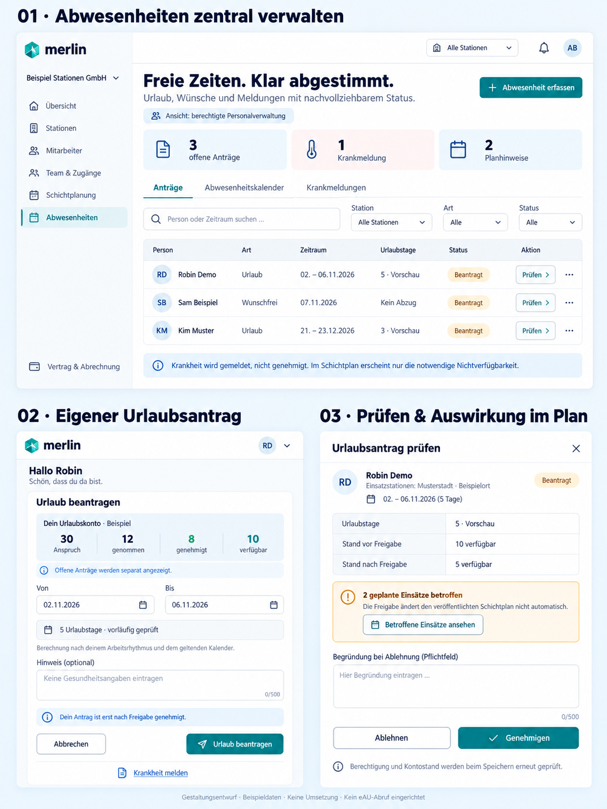
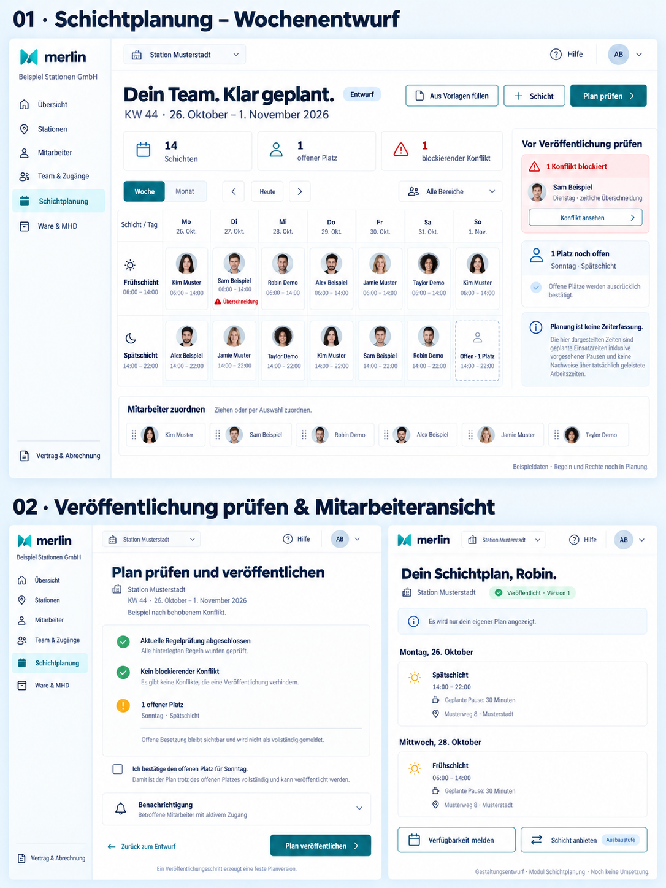
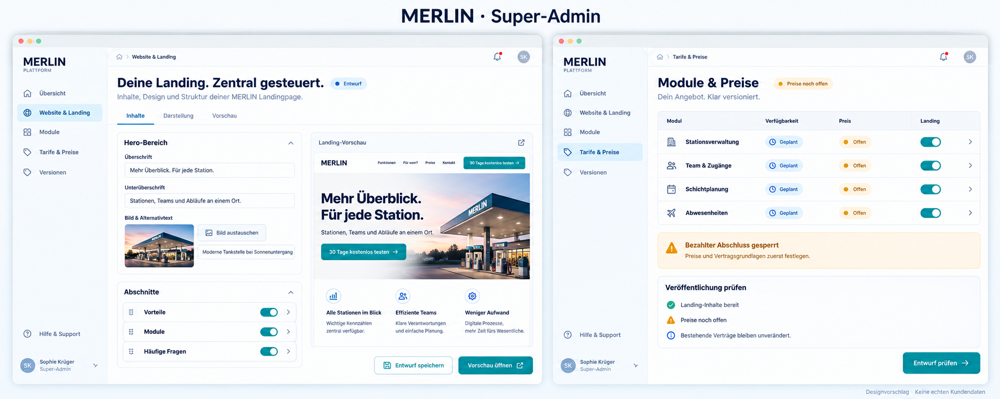
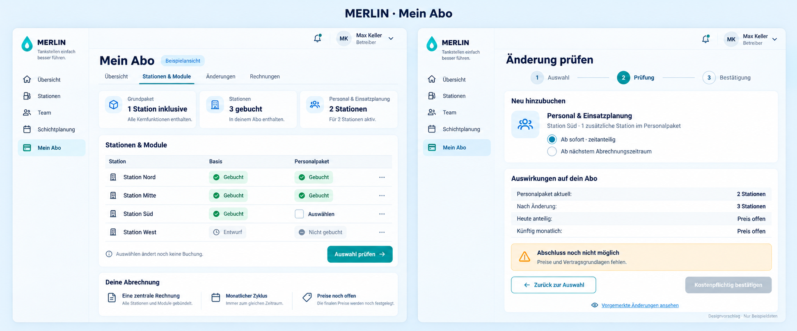

# Merlin Nova – Planung und Gestaltung

Gemeinsame Planungsablage für die schrittweise Neugestaltung von Merlin.
**Stand: 20. Oktober 2026 · Lokale technische Basis eingerichtet · Fachmodule in Planung.**

Laravel/Filament/MySQL unter `application/`: [Lokale Entwicklung](docs/leitfaeden/LOKALE-ENTWICKLUNG.md).
Technisches Adminpanel und getrennte Dev-/Testdatenbanken; keine Fachmodule.
Composer-Audit wartet auf die Cloud-Netzfreigabe für `packagist.org`.

## Auf einem anderen Rechner weiterarbeiten

```sh
git clone https://github.com/smp4000/Merlin_nova-space.git
cd Merlin_nova-space
```

Diesen Ordner in Codex öffnen. `AGENTS.md` verweist auf den aktuellen Stand.
Einstiegssatz: „Lies AGENTS.md und docs/planung/STATUS.md und setze die Planung fort.
Noch nichts programmieren.“

Der Chatverlauf wird dadurch nicht automatisch übertragen. Die Dokumente enthalten die Übergabe.
Ausführliche Anleitung: [Rechnerwechsel](docs/leitfaeden/RECHNERWECHSEL.md).

## Inhalt

| Bereich | Einstieg |
|---|---|
| Super-Admin: Landing & Preise | [Fachspezifikation](docs/planung/SUPER-ADMIN-LANDING-UND-PREISE.md) · [Prompt 10](docs/prompts/10-super-admin-landing-und-preise.md) |
| Grundpaket & Zusatzmodule | [Abrechnungsmodell und Beispiele](docs/planung/GRUNDPAKET-UND-ZUSATZMODULE.md) · [Prompt 11](docs/prompts/11-grundpaket-und-zusatzmodule.md) |
| Mein Abo | [Detailplanung](docs/planung/MEIN-ABO.md) · [Prompt 12](docs/prompts/12-mein-abo.md) |
| Erster Einrichtungsprompt | [Laravel, Filament und MySQL](docs/prompts/00-entwicklungsumgebung.md) – technische Basis jetzt ausdrücklich ausgeführt |
| Aktueller Stand | [STATUS](docs/planung/STATUS.md) |
| Interaktives Dashboard | [Vorschauquelle](docs/mockups/11-dashboard-interaktiv.html) · [Bedienung](docs/leitfaeden/DASHBOARD-INTERAKTIV.md) |
| Entscheidungen/offene Punkte | [ENTSCHEIDUNGEN](docs/planung/ENTSCHEIDUNGEN.md) |
| Arbeitsprotokoll | [PROTOKOLL](docs/planung/PROTOKOLL.md) |
| Bestand und Zielarchitektur | [BESTAND](docs/planung/BESTAND.md) |
| Team & Zugänge im Detail | [Spezifikation](docs/planung/TEAM-UND-ZUGAENGE.md) |
| Stationsverwaltung im Detail | [Spezifikation](docs/planung/STATIONSVERWALTUNG.md) |
| Mitarbeiter & Mitarbeitereinladung | [Spezifikation](docs/planung/MITARBEITER-UND-EINLADUNG.md) |
| DATEV-Grundlage und Grenzen | [Rechercheleitfaden](docs/leitfaeden/DATEV-GRUNDLAGE.md) |
| Schichtplanung im Detail | [Spezifikation](docs/planung/SCHICHTPLANUNG.md) |
| Regelprüfung und Quellen | [Regelleitfaden](docs/leitfaeden/RECHERCHE-SCHICHTREGELN.md) |
| Abwesenheiten und Urlaubskonto | [Spezifikation](docs/planung/ABWESENHEITEN.md) |
| Urlaub, Krankmeldung und eAU – Quellen | [Rechercheleitfaden](docs/leitfaeden/RECHERCHE-ABWESENHEITEN.md) |
| Spätere Programmierung am anderen Rechner | [Umsetzungsübergabe und Startprompt](docs/leitfaeden/UMSETZUNGSUEBERGABE.md) |
| Datenschutz und SEPA | [Planungsleitfaden](docs/leitfaeden/DATENSCHUTZ-UND-SEPA.md) |
| Modul-Prompts | [Übersicht](docs/prompts/README.md) |
| Alle Mockups | [Galerie und Hinweise](docs/mockups/README.md) |
| Referenzfoto | ATS_Petersberg.jpg bleibt lokal; Stationsmotiv ist in den Landing-Mockups enthalten. |

## Freigegebene Stilrichtung


## Interaktives Dashboard

[Vorschauquelle herunterladen/öffnen](docs/mockups/11-dashboard-interaktiv.html):
Stations-/Rollenwechsel, Navigation, Schichtzuordnung und Beispielanträge.
Die GitHub-Dateiseite führt HTML nicht aus. Nach Klonen lokal im Browser öffnen
oder in Codex als interaktive Vorschau anzeigen lassen.
Nur Beispieldaten und lokale Interaktionen, keine neue produktive Anwendung.

## Abwesenheiten



## Schichtplanung



Umsetzung später modulweise nach ausdrücklichem Auftrag; zwölf Bildmockups sind vorhanden,
ergänzt um die lokale technische Basis; spätere Fachmodule sind noch nicht implementiert
und nicht sämtlich fertig spezifiziert.

## Mitarbeiter & Mitarbeitereinladung


DATEV-orientierte Planung; Zielprogramm und konkrete Schnittstelle sind noch offen.

## Stationsverwaltung


## Team & Zugänge


## Grenzen dieser Ablage

- Bilder sind Gestaltungsvorschauen mit Beispieldaten, keine funktionsfähigen Oberflächen.
- Alte Projektarchive werden nicht öffentlich mitveröffentlicht.
- Zusätzlich ist die ausdrücklich freigegebene lokale technische Basis unter `application/` vorhanden.
  Fachmodule sind weiterhin nicht implementiert.
- Preise, Anbieter und rechtliche Texte sind offen; keine Mandatsgültigkeit oder DSGVO-Zertifizierung behauptet.
- GitHub-Repository ist öffentlich; nur zur Veröffentlichung bestimmte Planungsinhalte ablegen.

## Super-Admin: Landing und Modulpreise



Inhalte, Medien, Module und Preise zentral verwalten. Entwurf, Veröffentlichung und
bestehende Verträge bleiben getrennt. Preise und Geschäftsmodell noch festzulegen.

## Mein Abo



Paketmodell bestätigt, Preise offen. Keine produktive Buchung oder Installation.
