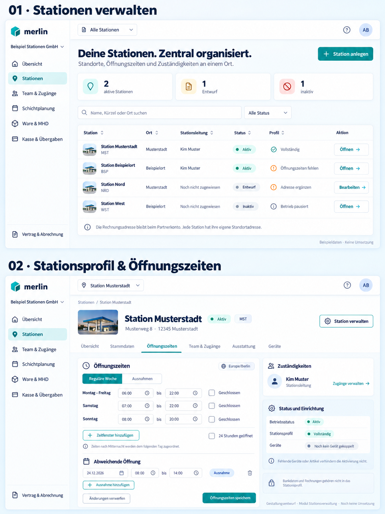
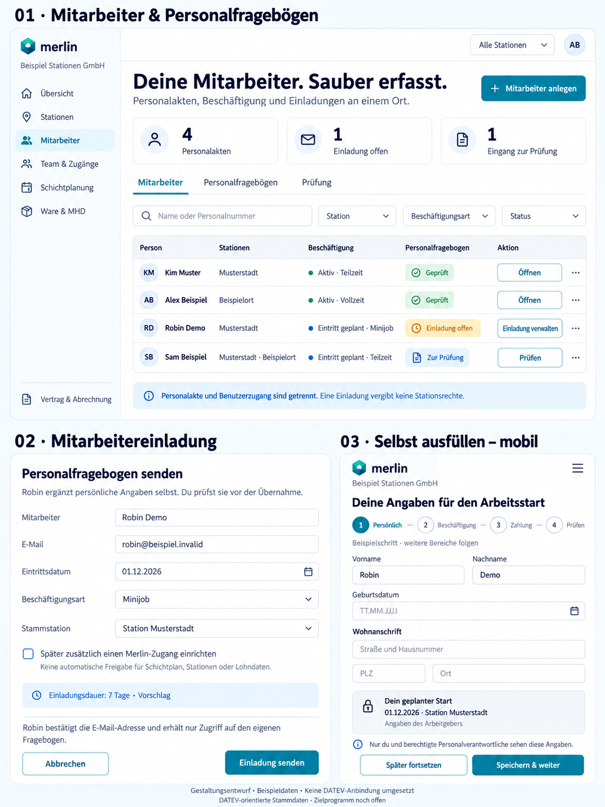

# Mockup-Galerie

Alle Bilder sind KI-generierte Rasterentwürfe, keine funktionsfähige Software.
Status/Nummern beziehen sich auf die Planungsreihenfolge, nicht auf Implementierung.

| Datei | Status | Bedeutung |
|---|---|---|
| [01](01-landing-erster-entwurf.png) | Überholt | Erster Waldgrün/Limette-Entwurf; nicht aktuelle Stilrichtung. |
| [02](02-landing-freigegebener-stil.png) | Stil bestätigt | Eisblau/Petrol, eigenes Stationsfoto, Preise offen. |
| [03](03-partnerregistrierung-uebersicht.png) | Konzept | Vier Ansichten vor Ergänzung des verpflichtenden SEPA-Schritts. |
| [04](04-partnerregistrierung-sepa.png) | Konzept | SEPA-Pflichtschritt; Betreiberangaben und Mandatstext fehlen bewusst. |
| [05](05-partner-dashboard.png) | Konzept | Erster Einstieg als Inhaber, eine Station, leere Fachbereiche. |
| [06](06-team-und-zugaenge.png) | Konzept, neu | Zugangsübersicht und Einladung mit Stations-/Rechteumfang. |
| [07](07-stationsverwaltung.png) | Konzept | Stationsübersicht und Profil mit Öffnungszeiten/Zuständigkeiten. |
| [08](08-mitarbeiter-und-einladung.png) | Konzept, neueste Ansicht | Mitarbeiterliste, Einladung zum Personalfragebogen und mobiler eigener Erfassungsbereich. |

## Bekannte Bildabweichungen – nicht als Anforderung übernehmen

- 01 ist nicht mehr aktuelle Gestaltung.
- 02 enthält „Bestände“/Bestandsübersicht: bisher kein festgelegtes Bestandsführungsmodul.
  Drei Abo-Karten sind Illustrationen, keine beschlossenen Tarife. SEPA-Pflichthinweis später ergänzen.
- 03 hat verkürzte/widersprüchliche Schrittanzeigen und „Firmenname laut Register“:
  nicht jede Gesellschaft ist eingetragen. Finaler Ablauf steht im Registrierungs-Prompt.
- 03/04 nennen keine automatische Verlängerung. Tatsächlich ist diese Geschäftsentscheidung noch offen.
- 04 zeigt kein fertiges bankakzeptiertes Mandat. Checkboxen und Platzhalter dürfen keinen
  gültigen Erteilungsprozess vortäuschen. „Keine Abbuchung“ gilt nur zum dargestellten kostenlosen Einstieg.
- 05 enthält interne Preismodell-Planung als UI-Text und „Bestände“ beim Import:
  später Enddatum/Vertragsstatus und Artikelstammdaten verwenden.
- 06 zählt im Reiter „Zugänge (3)“ eine offene Einladung mit; die Spezifikation verlangt
  getrennte Zählung, also im Beispiel 2 aktive Zugänge und 1 offene Einladung.
  In der unteren Ansicht ist Schritt 1 markiert, obwohl Stationen/Rechte sichtbar sind:
  später konsistente Schritte oder eine einheitliche Formularansicht wählen.
  „Einladung senden“ ist die ausdrückliche Versandbestätigung, kein zusätzlicher unklarer Folgeschritt.
  Rechte-Checkboxen sind beispielhaft, noch kein bestätigtes Rollenpaket.
- Logos unterscheiden sich leicht zwischen Bildern. Ein endgültiges Logo/Icon-System ist noch nicht festgelegt.
- 07 fasst Montag–Freitag für die Darstellung zusammen. Fachlich sind es Tagesregeln;
  der 24h-Modus gehört je Tag/Zeitplan, nicht als unklarer globaler Schalter unter alle Tage.
  Reguläre Woche und Ausnahmen sind gleichzeitig gezeigt, obwohl oben Reiter sichtbar sind:
  später entweder getrennte Reiter oder ausdrücklich eine gemeinsame Zusammenfassung wählen.
  „Vollständig“ bezieht sich auf das definierte Stationsprofil, nicht sämtliche Geräte-/Fachmodule.
  Kleine Stationsbilder sind generierte Platzhalter, keine echten Standortfotos.
  Einbindung von Stationsbildern ist noch keine beschlossene V1-Funktion.
  Inaktiv ist ein neutraler Betriebszustand, kein pauschaler roter Fehlerstatus.
- 08 zeigt eine verkürzte mobile Schrittfolge. Steuer/Sozialversicherung und nötige
  Nachweise fehlen als eigene Schritte im Bild, sind aber in der Fachspezifikation enthalten.
  Beschäftigungsspalte ist eine Zusammenfassung mehrerer Merkmale; Vollzeit/Teilzeit,
  Minijobprofil und Eintrittsstatus bleiben separate Datenfelder.
  Der Personalausschnitt ist eine berechtigte Personalverwaltungsansicht, nicht die
  Standardansicht jeder Stationsleitung. Ein Organisationsinhaber wird nicht automatisch
  als Beschäftigter angelegt; „Alex Beispiel“ ist nur ein frei gewählter Beispieldatensatz.
  „Geprüft“ heißt keine von DATEV bestätigte Übernahme. Separate Login-Vormerkung
  erzeugt keinen Zugang. 7 Tage Einladungsdauer bleiben Vorschlag.
  Der mobile Menüknopf darf nur eigene Erfassungsfunktionen, keine Administration öffnen.

## Vorschauen

### Aktuelle Landing-Richtung

### Registrierung

### SEPA-Schritt

### Partner-Dashboard

### Team & Zugänge

### Stationsverwaltung

### Mitarbeiter & Mitarbeitereinladung

